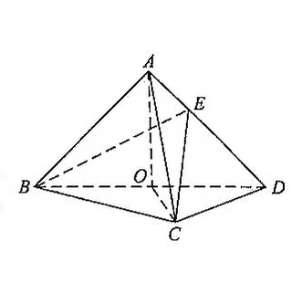

如图, 在三棱锥 $A-BCD$ 中, 平面 $ABD\perp$ 平面 $BCD$, $AB=AD$, $O$ 为 $BD$ 的中点.

(1) 证明: $OA\perp CD$;

(2) 若 $\triangle OCD$ 是边长为 $1$ 的等边三角形, 点 $E$ 在棱 $AD$ 上, $DE=2EA$, 且二面角 $E-BC-D$ 的大小为 $45^\circ$, 求三棱锥 $A-BCD$ 的体积.
