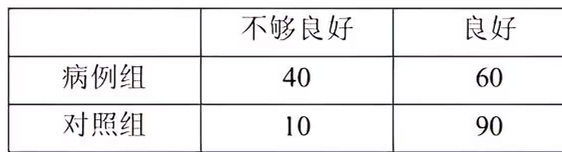
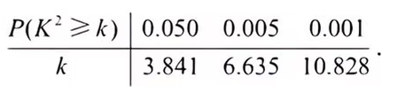

一医疗团队为研究某地的一种地方性疾病与当地居民的卫生习惯(卫生习惯分为良好和不够良好两类)的关系, 在已患该疾病的病例中随机调查了 $100$ 例(称为病例组), 同时在未患该疾病的人群中随机调查了 $100$ 人(称为对照组), 得到如下数据:

(1) 能否有 $99\%$ 的把握认为患该疾病群体与未患该疾病群体的卫生习惯有差异?

(2) 从该地的人群中任选一人, $A$ 表示事件 "选到的人卫生习惯不够良好", $B$ 表示事件 "选到的人患有该疾病", $\dfrac{P(B \mid A)}{P(\overline{B} \mid A)}$ 与 $\dfrac{P(B \mid \overline{A})}{P(\overline{B} \mid \overline{A})}$ 的比值是卫生习惯不够良好对患该疾病风险程度的一项度量指标, 记该指标为 $R$.

(i) 证明: $R=\dfrac{P(A \mid B)}{P(\overline{A} \mid B)}\cdot\dfrac{P(\overline{A} \mid \overline{B})}{P(A \mid \overline{B})}$;

(ii) 利用该调查数据, 给出 $P(A \mid B)$, $P(A \mid \overline{B})$ 的估计值, 并利用 (i) 的结果给出 $R$ 的估计值.

附: $K^2=\dfrac{n(ad-bc)^2}{(a+b)(c+d)(a+c)(b+d)}$,

