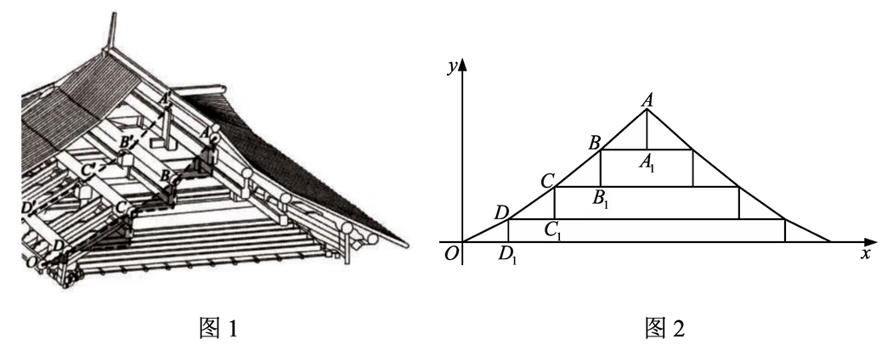

图 1 是中国古代建筑中的举架结构, $AA'$, $BB'$, $CC'$, $DD'$ 是桁, 相邻桁的水平距离称为步, 垂直距离称为举. 图 2 是某古代建筑屋顶截面的示意图, 其中 $DD_1$, $CC_1$, $BB_1$, $AA_1$ 是举, $OD_1$, $DC_1$, $CB_1$, $BA_1$ 是相等的步, 相邻桁的举步之比分别为 $\dfrac{DD_1}{OD_1}=0.5$, $\dfrac{CC_1}{DC_1}=k_1$, $\dfrac{BB_1}{CB_1}=k_2$, $\dfrac{AA_1}{BA_1}=k_3$. 已知 $k_1$, $k_2$, $k_3$ 成公差为 $0.1$ 的等差数列, 且直线 $OA$ 的斜率为 $0.725$, 则 $k_3=$

