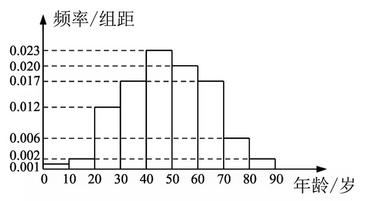

在某地区进行流行病学调查, 随机调查了 $100$ 位某种疾病患者的年龄, 得到如下的样本数据的频率分布直方图:

(1) 估计该地区这种疾病患者的平均年龄 (同一组中的数据用该组区间的中点值为代表);

(2) 估计该地区一位这种疾病患者的年龄位于区间 $[20,70)$ 的概率;

(3) 已知该地区这种疾病的患病率为 $0.1\%$, 该地区年龄位于区间 $[40,50)$ 的人口占该地区总人口的 $16\%$. 从该地区中任选一人, 若此人的年龄位于区间 $[40,50)$, 求此人患这种疾病的概率 (以样本数据中患者的年龄位于各区间的频率作为患者的年龄位于该区间的概率, 精确到 $0.0001$).
