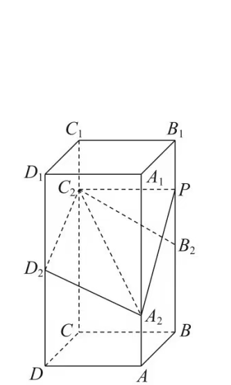

如图, 在正四棱柱 $ABCD-A_1B_1C_1D_1$ 中, $AB=2$, $AA_1=4$. 点 $A_2$, $B_2$, $C_2$, $D_2$ 分别在棱 $AA_1$, $BB_1$, $CC_1$, $DD_1$ 上, $AA_2=1$, $BB_2=DD_2=2$, $CC_2=3$.

(1) 证明: $B_2C_2//A_2D_2$;

(2) 点 $P$ 在棱 $BB_1$ 上, 当二面角 $P-A_2C_2-D_2$ 为 $150^\circ$ 时, 求 $B_2P$.
