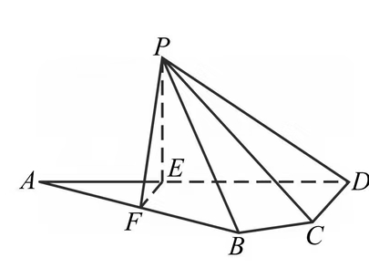

如图, 平面四边形 $ABCD$ 中, $AB=8$, $CD=3$, $AD=5\sqrt{3}$, $\angle ADC=90^\circ$, $\angle BAD=30^\circ$, 点 $E$, $F$ 满足 $\overrightarrow{AE}=\dfrac{2}{5}\overrightarrow{AD}$, $\overrightarrow{AF}=\dfrac{1}{2}\overrightarrow{AB}$. 将 $\triangle AEF$ 沿 $EF$ 翻折至 $\triangle PEF$, 使得 $PC=4\sqrt{3}$.

(1) 证明: $EF\perp PD$;

(2) 求面 $PCD$ 与面 $PBF$ 所成的二面角的正弦值.
